| | |
|---|---|
| **Student** | Baidildanov Almansur, 24B031671 |
| **Class time / day** | Thursday, 13:00–16:00 |
| **AI tool** | Claude Code 2.1.319 (CLI agent), model `claude-opus-5-5` (Claude Opus 5.5). See the note on Bolt below. |
| **Stack** | React 18 + TypeScript + Vite + Tailwind (same stack as the Bolt project), tests with Vitest 2.1 + Testing Library |
| **Project (GitHub)** | https://github.com/Almansur077/smart-campus-practice-09 (full source, Git history, tests, this report and all evidence). Run with `npm install && npm test`. |
| **Live demo, Practice #09 (published)** | https://almansur077.github.io/smart-campus-practice-09/ (GitHub Pages, built from this repository) |
| **Live demo, Practice #08 (before)** | https://smart-campus-room-av-cttt.bolt.host (Bolt Publish), used as the "before" reference in Section 7 |
| **Date** | 6 November 2026 |

**Note on the tool (honest scope).** The slides use Bolt.new. I used the Claude Code agent for every step instead. Bolt has the same concerns: it is not guaranteed to read `AGENTS.md` by itself, and it has no native skills or hooks. To match the slides, I followed their rules exactly: every prompt is the slide prompt, each step ran in a **fresh agent session** (no memory, no user settings, no MCP), and `AGENTS.md` was only used when the prompt asked the agent to read it. Raw logs of every run are in `evidence/ai_runs/raw_*.jsonl`. The original Bolt export was not in my files any more, so the starting code (`src/App.tsx`) was **restored from the published Bolt build** of Practice #08. Section 7 shows it gives the same 22 UI results as the live demo.

# 1. Scope and acceptance criteria (unchanged contract)

User story: *As a student, I want to check a room's availability so I can choose a valid booking time.* One room (B-204), fictional bookings, fixed demo clock `now = 540` (09:00), one booking 600–660. Availability decision only: no login, backend, database or saved bookings. I started from the repaired Practice #08 version, not a new generated app.

| AC | Rule | Protected by |
|---|---|---|
| AC1 | Reject start ≥ end and past requests | U01–U04, U11, D01–D04, R01, R02 |
| AC2 | Reject durations > 120 min | U05, U06, D05, R03, R04 |
| AC3 | Reject a blocked room | U07, D06, D08, R05 |
| AC4 | Reject overlaps; allow touching endpoints | U08–U10, D07, R06, R07 |
| AC5 | Do not mutate booking data | U13, D09, R08 (deep-frozen input) |
| AC6 | Clear desktop/mobile feedback | U12, U13 + 22 Chrome checks at 1280 px and 390 px (Section 7) |

# 2. Step 01: ask the agent to inspect, not edit

**Prompt 1 (slide text, plus the AC list from slide 12 as context):**

> Inspect this Smart Campus room availability project. Do not change files yet. Identify the booking-rule function, UI, fixture data and tests. List at most three maintainability problems with file references. Recommend ZERO, ONE or TWO patterns only if justified. Preserve AC1–AC6 and the existing UI.

The session had **read-only tools** (Read, Glob, Grep), so it could not edit anything. Response summary (full text: `evidence/ai_runs/response_step1_inspect.md`):

| Part | Found by the agent |
|---|---|
| Booking rule | `checkAvailability()` in `src/App.tsx:27-64` (+ `overlaps`, `isWholeMinute`, `formatTime`) |
| UI | `App` component in `src/App.tsx:98-243`, `validateRequired`, parsing in `handleSubmit` |
| Fixture | `DEMO_ROOM` in `src/App.tsx:74-78`, copied into state (protects AC5) |
| Tests | `tests/ui.regression.test.tsx` U01–U13 (my characterization tests, written before any change) |

Maintainability problems it listed: **(1)** everything is in one file and the rule is not exported, so it can only be tested through the UI; **(2)** "B-204" is hard-coded and the `blocked` flag is stored twice; **(3)** input checking is split over three places (`parseInt` turns `"660.5"` into `660`). **Patterns recommended: none.** It recommended a plain *Extract Module* refactor and explicitly warned against Strategy and Chain of Responsibility because they could change the check order and the exact messages.

# 3. Step 02: select one small refactoring

| | Decision |
|---|---|
| **Problem chosen (one)** | UI and validation are tightly coupled: the pure rule and the fixture live inside the React component file `src/App.tsx`, so AC1–AC5 can only be tested by rendering the whole page, and every UI edit touches the rule file. |
| **Solution** | Preferred minimal solution from the slide: **small module boundary**. Extract the pure availability function into `src/domain/availability.ts` and the fixture into `src/data/demoRoom.ts`. |
| **Adapter?** | **Skipped.** There is only one booking shape, `{start, end}`. No fixture uses `{startTime, endTime}`, so there is nothing to normalize. |
| **Strategy?** | **Skipped.** There is only one booking policy. A simple function is better (slide 24). |
| **Not done on purpose** | Problems (2) and (3) from Step 01 would change behaviour or add a feature, so they are listed as limitations (Section 10). |

**Two-sentence rationale:** *Problem:* the booking rule was hidden inside the UI component, so it could only be tested through the form and any UI change risked the rule. *Pattern → benefit:* a small module boundary (pure function in `domain/`, fixture in `data/`) lets AC1–AC5 be unit-tested in milliseconds without the DOM, while the UI and its messages stay exactly the same.

**Pattern rationale (submission text, 123 words).** The Smart Campus checker had one real maintainability problem: the booking rule, its helpers and the demo fixture were written inside the React component file, so AC1–AC5 could only be tested by rendering the whole page, and any UI edit touched the rule. I applied one small pattern, a module boundary in the "functional core, imperative shell" style. The pure `checkAvailability` function and `formatTime` moved to `src/domain/availability.ts`, the fixture moved to `src/data/demoRoom.ts`, and `App.tsx` now handles only state, parsing and rendering. The benefit is 19 fast unit tests on the rule, with no UI change. I rejected Adapter, because there is only one `{start, end}` data shape, and Strategy, because there is only one booking policy. Both would add code without solving anything.

# 4. Steps 03–04: AGENTS.md and explicit activation

`AGENTS.md` is at the project root (`smart-campus/AGENTS.md`, copy at the top of the submission). It documents purpose, structure, AC1–AC6, engineering rules (at most 2 justified patterns, no Singleton/Factory/hierarchies, keep check order and message text), commands (`npm test`, `npm run typecheck`, `npm run build`) and verification rules.

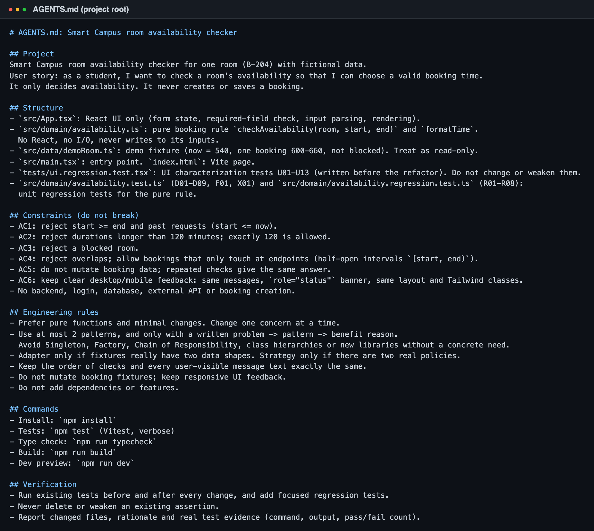

**Prompt 2 (Step 04, slide text):**

> Read the root AGENTS.md before making changes. Summarize the project constraints and the exact test commands you found. Do not edit anything yet. If you cannot read AGENTS.md, tell me and I will paste its content. Do not claim that AGENTS.md was automatically loaded.

Response (full: `evidence/ai_runs/response_step4_activate.md`): the log shows `TOOL CALL: Read AGENTS.md` as the **first action**. The agent wrote *"I read `AGENTS.md` at the repository root with the Read tool"*, so it did **not** claim the file was loaded automatically. It summarized AC1–AC6, the "no backend/login/booking creation" limit and the pattern rules correctly. It listed the exact commands and checked them against `package.json` (`npm test` → `vitest run --reporter=verbose`, `npm run typecheck` → `tsc --noEmit`). It also pointed out that the `preview` script is not documented in AGENTS.md.

# 5. Step 05: implement one focused change

**Prompt (Step 05):**

> Read the root AGENTS.md and follow it. Implement one focused change for the problem we identified: […] Extract the pure availability function (and formatTime) into src/domain/availability.ts and the fixture into src/data/demoRoom.ts, keeping the existing function signature, messages, check order, UI markup and behaviour unchanged. Apply a pattern only if it solves this identified design problem. Do not add new features or dependencies. Show the files you plan to edit before making changes, then make the change and run npm test and npm run typecheck.

The agent ran the tests first (13/13), made the change, and ran the tests again. **I reviewed the diff line by line** (`evidence/code_diff_refactor.diff`): the rule, helpers and every message string were moved **unchanged**, and `App.tsx` lost 68 lines and gained 2 import lines. No JSX or Tailwind class changed. I then committed it as one separate commit (`6f94a9b`).

| Changed file | Change |
|---|---|
| `src/domain/availability.ts` | **new**: pure `checkAvailability`, `formatTime`, types, `MAX_MINUTES` (no React, no I/O) |
| `src/data/demoRoom.ts` | **new**: `DEMO_ROOM` fixture, values unchanged |
| `src/App.tsx` | rule and fixture removed, 2 imports added. UI, parsing, markup unchanged |
| `src/domain/availability.test.ts` | **new**: D01–D09, F01, X01 (written by the agent, committed separately as `10b5eb7`) |
| `src/domain/availability.regression.test.ts` | **new**: R01–R08 (Step 06) |
| `AGENTS.md`, `package.json` | AGENTS.md added and updated after the refactor; `test` script made verbose |
| `tests/ui.regression.test.tsx` | **not changed** (`git diff d291275 HEAD -- tests` = 0 lines) |

**What the agent changed that I did not ask for in that prompt:** it also wrote a unit-test file (D01–D09). AGENTS.md does ask for "focused regression tests", so I kept it, but in a separate commit so the refactor commit only contains the move.

# 6. Step 06: generate and review tests

**Prompt (Step 06, slide text):** *"Create or update regression tests for: past time, reversed interval, 121-minute duration, blocked room, overlap, touching endpoints and unchanged fixtures. Explain each expected result from AC1–AC6. Do not weaken or delete existing assertions."*

The agent added `R01–R08` in a new file and did not edit any existing test. Each test checks the full result (`available` + exact message):

| Test | Case | Expected, from AC |
|---|---|---|
| R01 | past time 539–560, 0–60; control 541–600 | rejected (AC1: start must be after now = 540); 541 allowed |
| R02 | reversed 841–720, 500–400 | rejected with the "reversed" message (AC1; reversed check runs before past check) |
| R03 | 121 min (720–841, 1319–1440); 120 min controls | rejected with "this request is 121 minutes" (AC2); exactly 120 allowed |
| R04 | 600–721 (too long and overlapping) | duration message wins (check order kept) |
| R05 | blocked room: free, 120-min and overlapping slots | always "blocked" (AC3) |
| R06 | 5 overlap shapes (edge, inside, covering, identical) | rejected (AC4, half-open `[start, end)`) |
| R07 | 660–720, 550–600, gap 660–720 between two bookings | allowed (AC4 touching endpoints) |
| R08 | 7 cases on a **deep-frozen** fixture, run twice | same answer twice, `DEMO_ROOM` identical afterwards (AC5) |

**My review: do the tests really catch bugs?** The agent itself wrote *"I didn't check that each one fails when the rule it guards is broken"*. So I did a **mutation check** (`evidence/mutation_check.sh`): I broke one rule at a time, ran the full suite and restored the file.

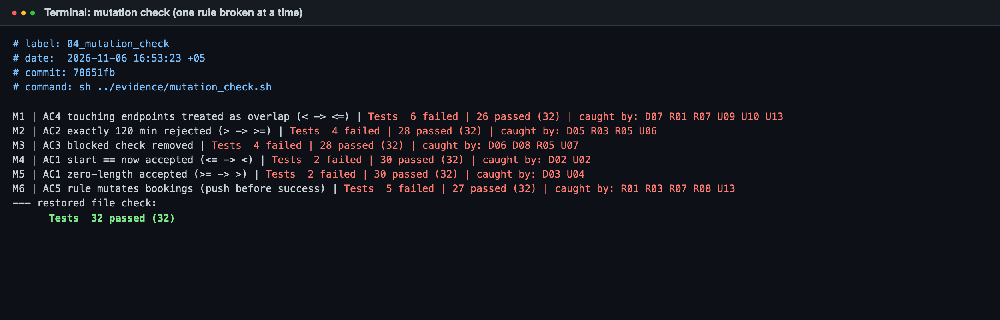

All 6 injected bugs were caught. One gap the check found: the AI's R-tests do **not** catch M4 (`start == now` accepted), because R01 tests 539 and 541 but not 540. Only my earlier U02 and the agent's D02 catch it. This shows why tests generated by AI must still be reviewed by a person.

# 7. Step 07: run and verify (before vs after)

**Tests.** Command `npm test` (Vitest), plus `npm run typecheck` and `npm run build`:

| Run | Commit | Result |
|---|---|---|
| Baseline, before refactor (`01_baseline_before_refactor.txt`) | `d291275` | **13 passed (13)**, typecheck OK |
| After refactor, UI tests unchanged (`02_after_refactor_ui_tests_unchanged.txt`) | `6f94a9b` | **13 passed (13)**, typecheck OK, build OK |
| Final full suite (`03_final_full_suite.txt`) | `78651fb` | **3 files, 32 passed (32), 0 failed**, typecheck OK, build OK |

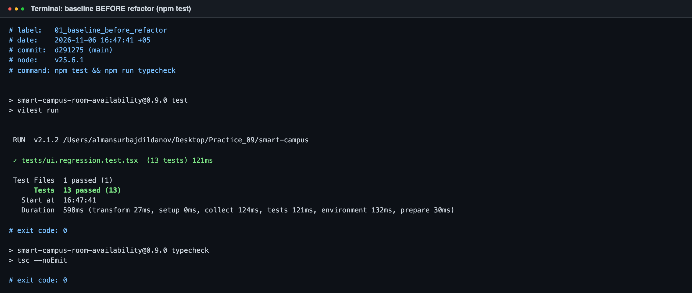

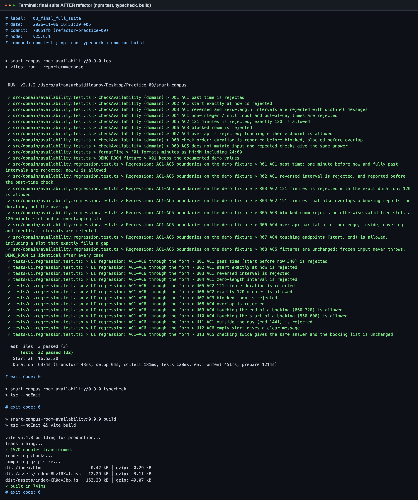

**UI, before vs after.** A headless Chrome script (`evidence/ui_results.json`) filled the real form for 11 cases at **desktop 1280 px** and **mobile 390 px**. It ran them on the **live Practice #08 demo** (before) and on the **published Practice #09 build on GitHub Pages** (after). Each case was submitted twice to check repeatability and that the room info did not change.

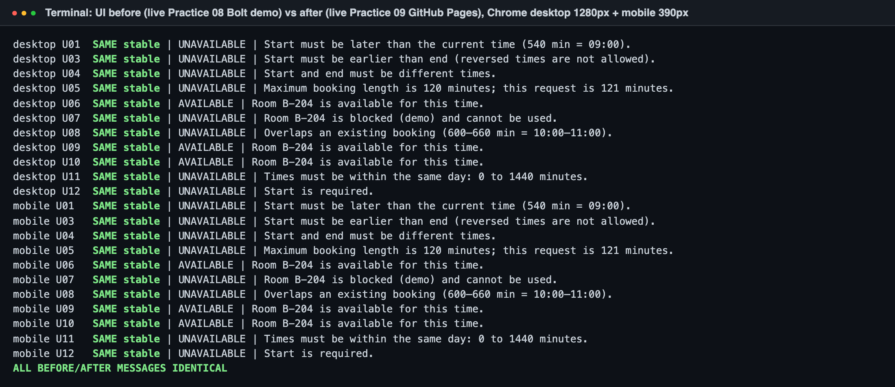

Result: **22/22 messages identical before and after**, every repeat gave the same answer, and the booking list never changed.

| Before (live Practice #08), desktop | After (Practice #09, GitHub Pages), desktop |
|---|---|
| 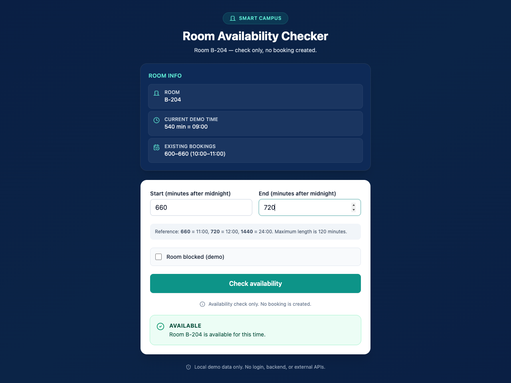 |  |
|  | 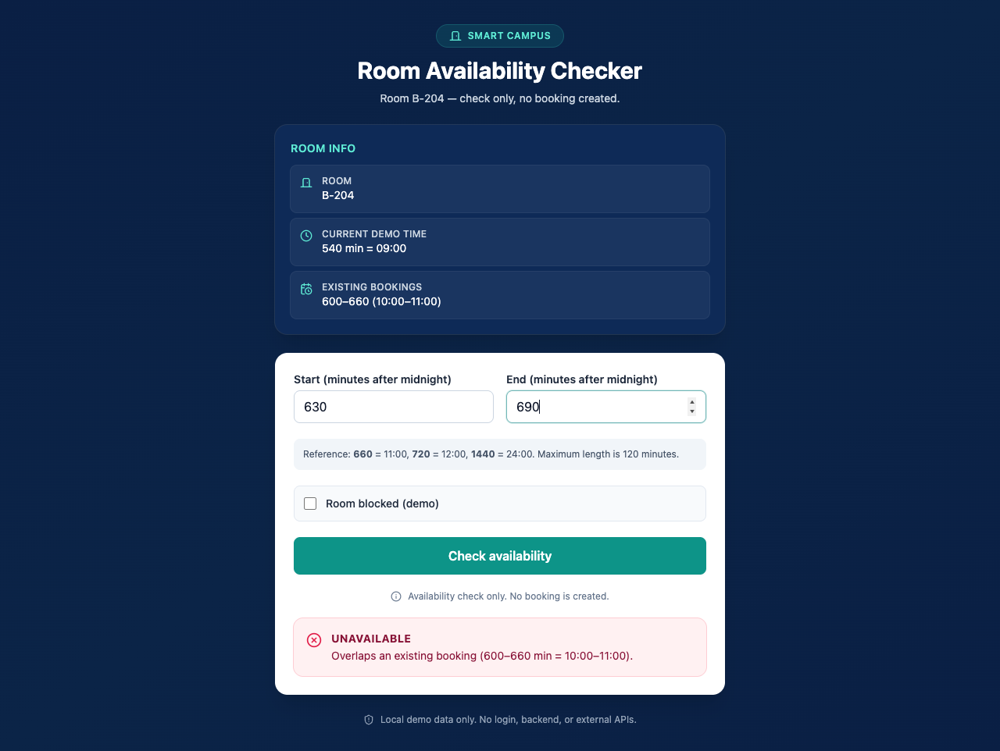 |

| Before, mobile (overlap) | After, mobile (overlap) | After, mobile (121 min) | After, mobile (blocked) |
|---|---|---|---|
| 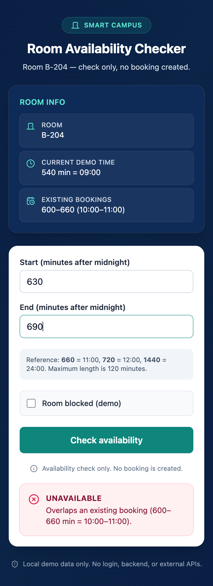 | 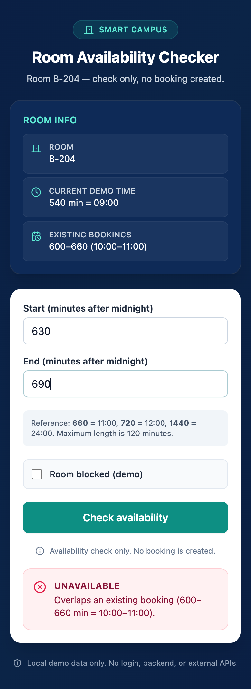 |  | 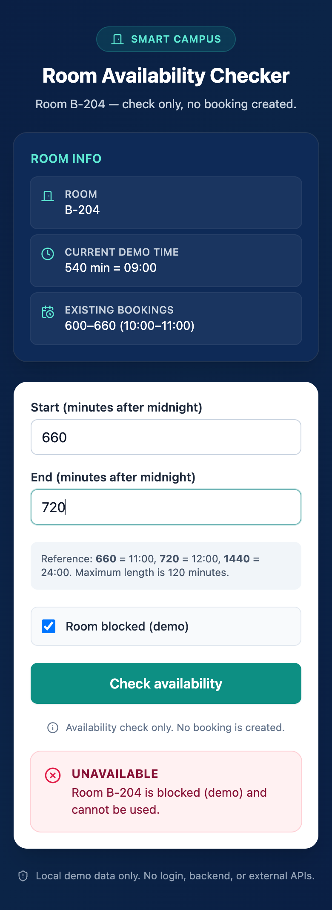 |

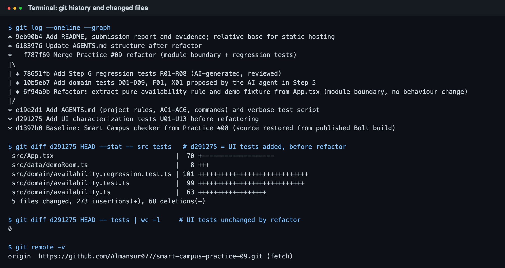

# 8. Experiment: with vs. without AGENTS.md

Same project state, two **separate fresh sessions**, read-only tools.

* **A (no AGENTS.md mentioned):** *"Suggest a refactoring for this Smart Campus room availability project and say which design patterns you would apply. Do not edit files."* Run on commit `d291275`, before AGENTS.md existed.
* **B (AGENTS.md explicitly provided):** *"Read the root AGENTS.md first and follow its constraints. Then suggest a refactoring […]"* Run on commit `e19e2d1`.

| Criterion | A: without instructions | B: with AGENTS.md |
|---|---|---|
| Scope control | 12+ new files (`domain/time.ts`, `timeRange.ts`, `rules.ts`, `ui/useAvailabilityCheck.ts`, components…) and 6 refactor steps | 2 new files, exactly the planned boundary |
| Unnecessary patterns | **6 patterns**: Chain of Responsibility, Strategy, Value Object, Dependency Injection, Container/Presentational, Factory functions | **1 (optional 2)**, each with problem → pattern → benefit; Strategy, Adapter, CoR, Factory, Singleton explicitly rejected with reasons |
| Behaviour risk | Suggested making the room name data-driven (changes messages) and a new rule list | Explicitly listed what *not* to change (parsing, B-204 text, Tailwind classes) |
| Test quality | "Add unit tests per rule", no concrete cases | Concrete cases: 120/121, touching endpoints, check order, frozen input |
| Clarity | Long, many options | Short, one ordered plan with commands |

**Conclusion.** With the constraints supplied explicitly, the agent stayed in scope and avoided pattern over-use. Without them, it proposed a large architecture for a 60-line rule. This is **not proof** that the tool loads AGENTS.md automatically. In B the log shows the agent read the file only because the prompt told it to. Each condition ran once, so part of the difference may be random.

# 9. Reflection on AI recommendations

* **Did a pattern actually reduce complexity?** The useful change was a **module boundary**, not a GoF pattern. `App.tsx` went from 243 to 177 lines and contains only UI. The rule is now one small pure file with 19 direct unit tests that run in about 5 ms (the 13 UI tests need about 120 ms). Strategy and Adapter would have added code with no benefit, because there is one policy and one data shape.
* **What did the AI change that I did not request?** In Step 05 it also wrote a test file. It was in scope and good, but it was not part of the prompt, so I committed it separately. It did not change any UI, message or existing test.
* **How did AGENTS.md affect the outcome?** It cut the proposed patterns from 6 to 1 and kept the plan inside the agreed boundary. The agents in Step 05/06 used exactly the commands AGENTS.md lists, and they kept the rule "never weaken an existing assertion": no existing test was edited.
* **What evidence proves behaviour was preserved?** (1) The 13 UI tests were written before the refactor and pass unchanged before and after. (2) 22/22 identical UI results against the live Practice #08 demo at desktop and mobile size. (3) 32/32 tests, typecheck and build all pass. (4) The mutation check shows the tests do detect broken rules.
* **Main lesson:** AI output still needs a human to check it. The agent said honestly that it had not checked whether its tests fail, and my mutation check found a real gap (M4). Generated tests are a starting point, not proof.

# 10. Remaining limitations

* The Practice #09 demo is published on GitHub Pages, not with Bolt's Publish button, because the work was done with Claude Code. It gives the same 22 UI results as the Bolt demo from Practice #08 (Section 7).
* Commit hashes: the author e-mail was set to my university address before pushing, so the history was rewritten once. The hashes in this report and in `evidence/` are the final ones on GitHub.
* `src/App.tsx` was restored from the published Bolt build because the original Bolt export was missing. The UI comparison shows identical behaviour.
* Not fixed on purpose, because fixing would change behaviour: `parseInt` truncates `"660.5"` to `660`; "B-204" is hard-coded in the messages; the fixture's `blocked` field is overridden by the checkbox.
* No real-phone or screen-reader test. Mobile was checked with Chrome emulation at 390×844.

# Appendix: files

| Path | Content |
|---|---|
| `AGENTS.md` | Repository instructions (copy of `smart-campus/AGENTS.md`) |
| repository root | Full project source with Git history (`git log --oneline --graph`); report and evidence are in `submission/` |
| `evidence/ai_runs/prompt_*.md`, `response_*.md`, `raw_*.jsonl` | All prompts, AI responses and raw agent logs (Steps 01, 04, 05, 06, experiment A/B) |
| `evidence/test_output/01..05_*.txt` | Real terminal outputs |
| `evidence/ui_results.json` | 44 UI results (2 targets × 2 devices × 11 cases) |
| `evidence/code_diff_refactor.diff`, `git_log.txt`, `mutation_check.sh` | Diff, history, mutation script |
| `evidence/screenshots/` | UI and terminal screenshots |
